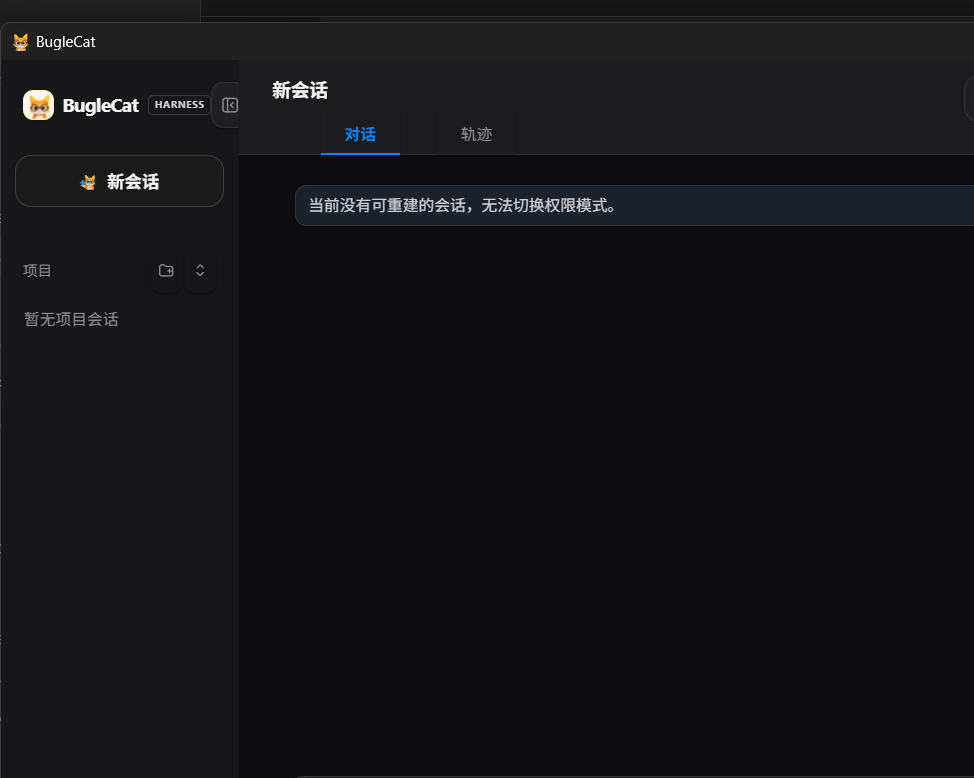

# BugleCat

[English](README.md) | 简体中文

**BugleCat** 是一个本地运行且可扩展的 Codex 风格编码 Agent。chat-completions 模型提出结构化工具调用，Agent 在沙箱与审批策略下执行文件/shell/LSP/终端工具，记录会话与事件快照，并循环直到任务完成。它可以对接 DeepSeek 托管 API，也可以对接任意 OpenAI 兼容的本地模型，并自带 MCP 集成、插件生态、Skills 系统、上下文压缩、token 成本统计、定时器、git worktree 的 A/B 对比，以及 Tauri 2 + Svelte 5 桌面客户端。

[](nanocodex.html)

[能力说明页](nanocodex.html) · [更新日志](CHANGELOG.zh-CN.md) · [下载发布包](https://github.com/dgy-github/BugleCat/releases/latest) · [设计说明 PDF](docs/ai-coding-agent-design-brief.pdf) / [HTML](docs/ai-coding-agent-design-brief.html)

设计文档：
[设计理念手册](docs/design-philosophy.zh-CN.md) ·
[上下文压缩安全协议](docs/context-compression-safety-protocol.zh-CN.md) ·
[智能复利回流与 60 分奇点方案](docs/intelligence-compounding-feedback-plan.zh-CN.md) ·
[自进化 Harness 架构（对照 RRSI & Harness²）](docs/self-evolving-harness-rrsi-harness2.zh-CN.md) ·
[Harness² 接入 forge](docs/harness2-forge-integration.zh-CN.md)

## 当前状态一览

- **当前主线：** `rust/` 下的 Rust 运行时（`ncx.exe` CLI + Tauri 桌面端），处于第三阶段（智能复利）。Python 版 `nanocodex/` 作为历史参考实现保留；为兼容已有安装，`~/.nanocodex/`、`NANOCODEX_*`
  环境变量和 Python 命令中仍沿用旧名称。
- **最新发布：** [`v0.1.3`](https://github.com/dgy-github/BugleCat/releases/tag/v0.1.3) —— Windows 安装包与便携包（`v0.1.2` 同时提供 macOS DMG）。
- **最近更新（2026-10-23）：** 新增 Windows AppContainer OS 级 shell 沙箱隔离（`os_sandbox = "enforce"`）、非只读工具执行前 Jev 动作复核（`action_review.rs`），以及 shell 审批、进程管控、Propose–Probe–Compose、forge 验收门和记忆护栏的审查修复，见 [更新日志](CHANGELOG.zh-CN.md)。
- **值得了解的默认值：** `sandbox_mode = "workspace-write"`、`os_sandbox = "off"`、`approval_policy = "on-request"`。在线复利反馈（`[feedback] memory` / `routing`）默认是 `"shadow"`：只观察、记录反事实结果和待审阅候选，不写入学习笔记，也不改变路由；切换到 `"on"` 需要先满足 14 天基线门槛。
- **已知限制：** 默认（`os_sandbox = "off"`）下沙箱是策略级的；在 Windows 上开启 `os_sandbox = "enforce"`（或 `NCX_OS_SANDBOX=enforce`）后，可由 Windows AppContainer 强制执行文件系统与网络隔离（非 Windows 平台请求 `"enforce"` 时 fail-closed）。MCP 服务和 Hooks 运行在沙箱之外；复利回放的成本结论仍是初步结果（9 道题）。

## 目录

- [安装](#安装)
- [快速开始](#快速开始)
- [亮点](#亮点)
- [架构](#架构)
- [项目阶段](#项目阶段)
- [工具](#工具)
- [配置](#配置)
- [沙箱与审批](#沙箱与审批)
- [智能复利闭环](#智能复利闭环)
- [自进化 Harness](#自进化-harness)
- [评测与证据](#评测与证据)
- [自定义 Slash Commands](#自定义-slash-commands)
- [本地模型 / OpenAI 兼容接口](#本地模型--openai-兼容接口)
- [MCP](#mcp)
- [插件生态](#插件生态)
- [Skills](#skills)
- [记忆与 AGENTS.md](#记忆与-agentsmd)
- [会话、恢复与历史](#会话恢复与历史)
- [上下文压缩](#上下文压缩)
- [Token 用量与成本](#token-用量与成本)
- [定时器](#定时器)
- [A/B worktree 对比](#ab-worktree-对比)
- [BugleCat 桌面端](#buglecat-桌面端)
- [测试](#测试)
- [Release 打包](#release-打包)
- [安全说明](#安全说明)
- [合作](#合作)
- [许可证](#许可证)

## 安装

### 方式一：直接下载预编译包（推荐）

前往 [GitHub Releases (`v0.1.3`)](https://github.com/dgy-github/BugleCat/releases/tag/v0.1.3) 直接下载：

- **Windows 安装包（NSIS）**：`BugleCat_0.1.0_x64-setup.exe`
- **Windows CLI 便携运行包（`ncx.exe`）**：`BugleCat-0.1.3-x86_64-pc-windows-msvc.zip`（含完整离线核验工具的便携包亦可在 [`v0.1.2`](https://github.com/dgy-github/BugleCat/releases/tag/v0.1.2) 下载 `buglecat-20261014-final.zip`）
- **macOS 安装包（[`v0.1.2`](https://github.com/dgy-github/BugleCat/releases/tag/v0.1.2)）**：`BugleCat-arm64.dmg`（Apple Silicon） / `BugleCat-x64.dmg`（Intel）

### 方式二：从源码构建

当前 Rust release 线：

```powershell
cd path\to\BugleCat
rustup toolchain install stable-x86_64-pc-windows-msvc
cargo +stable-x86_64-pc-windows-msvc build --manifest-path rust\Cargo.toml -p ncx-cli --release

cd rust\gui
npm ci
npm run tauri:build
```

这需要 Rust toolchain 和 Node.js 18 或更新版本。原 Python 实现仍可用于参考和原型：

```powershell
cd path\to\BugleCat
python -m pip install -e ".[dev]"
```

需要 Python ≥ 3.11。

## 快速开始

Rust CLI，当前 release 线：

```powershell
cd rust
cargo run -p ncx-cli -- "summarize this repository"
cargo run -p ncx-cli
cargo run -p ncx-cli -- --resume
cargo run -p ncx-cli -- --history
cargo run -p ncx-cli -- --memory-merge
cargo run -p ncx-cli -- --outcomes report --since 30d --by category,model,policy
cargo run -p ncx-cli -- --outcomes bootstrap D:\repo1 D:\repo2  # 扫描多个仓库历史会话冷启动提取全局 ACR 指标
cargo run -p ncx-cli -- --memory-review                         # list | confirm <id> | reject <id> | restore <id>

# Tauri 桌面开发版
cd gui
npm ci
npm.cmd run tauri -- dev --target x86_64-pc-windows-msvc
```

Rust REPL 里可以用 `/config` 查看解析后的配置文件路径、当前 model/sandbox/approval
值和可写 key。`/config key=value` 会把设置持久写入 `~/.nanocodex/config.toml`（将 `feedback.memory=on` 或 `feedback.routing=on` 开启时会校验 14 天 Shadow 基线门禁，加 `--force` 可强制跳过）；
provider、model、sandbox 或预算类变更需要重启 REPL 后影响当前会话。`/usage`（或
`/cost`）会显示上一轮和当前 REPL session 的原始 token 用量；`/outcome good|bad [note]` 可对上一轮主任务打人工标签，`/outcome report` 查看当前工作区 ACR 与 60 分奇点报告。

旧版 Python CLI（为兼容已有用户，命令名仍保留 `nanocodex`）：

```powershell
# 一次性任务
nanocodex "add a --json flag to the CLI"

# 在当前目录交互
nanocodex --cd .

# 启用 MCP 服务
nanocodex --mcp

# 启动 GUI
nanocodex-gui --cd .
```

旧版 Python GUI 在 Windows 上仍可双击 `nanocodex-gui.cmd`，或用
`scripts/make-shortcut.ps1` 生成开始菜单快捷方式。

## 亮点

- **Codex 风格 agent 循环** —— 流式 token 输出、多轮工具调用、可取消、按轮统计
  用量。
- **DeepSeek + 任意 OpenAI 兼容后端** —— 把 `base_url` 指向托管 API 或本地服务
  （vLLM、llama-server、LM Studio……）。
- **沙箱与审批状态机 + Windows AppContainer 隔离 + Jev 工具执行前动作复核** —— 三种沙箱模式、四种审批策略拦截每一次文件/shell/网络动作；`os_sandbox = "enforce"` 在 Windows 上提供 AppContainer 内核级文件/网络隔离，`jev_mode = "shadow" | "enforce"` 在非只读工具执行前对 `not_requested`、`exceeds_scope`、`irreversible` 三个 Noul 进行复核。
- **MCP 集成 + 市场** —— 从 `mcp.toml` 加载服务，或从内置 / 远程目录一键安装；
  工具保留服务端提供的名称，重名会被拒绝；`/mcp reload` 支持进程内原子热重载外部工具集。
- **插件生态** —— 可从本地、Git、NPM 或社区市场安装兼容 Codex 的资源插件，把
  Skills、MCP、Apps、Hooks 和 UI 插槽组合发布，并在安装前检查兼容性和能力冲突。
- **可插拔 Agent 运行时** —— 模型 Provider、轮次上下文、工具注册表、调度器、中间件与权限配置均为显式运行时接缝，CLI 与 GUI 共享同一套装配契约。
- **Harness 工具族** —— 真实 LSP 查询、有界后台进程、持久原生 PTY 终端会话、结构化工作区巡检、Web 工具与会话检索。
- **Skills 系统** —— 用户 skill 加三个内置编码 skill；只注入名称 + 描述，正文
  按需加载。
- **自定义 slash commands** —— 项目/用户级 Markdown prompt 模板放在
  `.nanocodex/commands`，并兼容 `.claude/commands`。
- **持久记忆 + AGENTS.md / CLAUDE.md** —— 每轮注入的持久笔记和分层项目指令。
- **跨 Agent 长期记忆插件** —— 随仓库提供的 LLM Wiki 示例用自动触发 Skill 配合
  本地 MCP，在 BugleCat 与其他 Agent 客户端之间召回用户偏好和项目快照。
- **可浏览的会话历史** —— JSONL 日志、完整对话快照、恢复（resume）和分叉（fork）。
- **上下文压缩** —— 零成本的确定性摘要，或可选的模型摘要，按 token 预算触发。
- **缓存感知的成本统计** —— 用真实的按调用用量，按 DeepSeek 的命中/未命中费率
  计价。
- **自适应推理强度** —— `auto` 档根据请求选 `max`/`high`/`low`（多语言关键词表：
  英文 / 中文 / 日本語）。
- **定时器** —— 一次性/周期性保存的 prompt，连续失败自动禁用。
- **A/B worktree 对比** —— 同一 prompt 在两个隔离的 git worktree 里各跑一套配置，
  对比 diff/成本/延迟，采纳其中一侧。
- **prompt 增强、图片输入、中文优先回复**，以及基于 **Tauri 2 + Svelte 5** 的跨平台桌面客户端。

## 架构

```text
rust/
├── crates/
│   ├── ncx-config/        # 分层配置解析与运行时限额
│   ├── ncx-provider/      # 可替换的 OpenAI 兼容 / Anthropic 模型边界与诊断脱敏
│   ├── ncx-sandbox/       # 沙箱策略与四档审批状态机
│   ├── ncx-tools/         # 进程执行器（Job Object / 进程组管控 + Windows AppContainer 隔离）、后台任务、PTY、文件与补丁工具
│   ├── ncx-mcp/           # MCP 传输层、协议版本校验与外部工具热重载
│   ├── ncx-context/       # 关联记忆与上下文检索
│   ├── ncx-thread-store/  # 持久化会话与事件存储
│   ├── ncx-protocol/      # GUI / App Server 强类型协议契约（唯一事实源）
│   ├── ncx-app-server/    # 桌面端与宿主服务桥接层
│   ├── ncx-core/          # AgentLoop、ToolRegistry、中间件、声明核验与执行前动作复核（verification）及编排器
│   └── ncx-cli/           # 一次性与交互式命令行前端（ncx.exe）
└── gui/
    ├── src/               # Svelte 5 桌面 UI
    └── src-tauri/         # Tauri v2 原生宿主命令与共享运行时装配

nanocodex/                 # 第一阶段 Python 参考与兼容原型实现
```

### 运行时控制面

- **Task budget（任务预算）：** 每次模型调用都会收到当前运行预算，包括模型调用次数、工具调用次数
  和上下文限制；模型调用或工具调用超预算时，loop 会干净停止，补齐未执行工具调用的
  tool result，并如实报告未完成的校验状态。
- **Context editing（上下文编辑）：** 本地完整 session 不会被删；发给 provider 的是发送时编辑视图，
  会压缩旧 tool result，并在超过上下文预算时丢弃更早的前缀。
- **Tool search（按需工具暴露）：** 工具注册时会进入 catalog。小工具集仍全量暴露；工具变多时只暴露核心
  工具和 `tool_search`，搜索命中的工具会在下一轮 schema 里出现（默认单轮最多暴露 16 个 schema）。
- **Harness 工具族：** Rust 运行时内置真实的 `rust-analyzer` LSP provider、带增量输出的有界后台进程，以及支持原始 stdin、光标读取、尺寸调整和关闭的持久 ConPTY/PTY 终端；Windows 子进程以挂起方式启动并纳入 Job Object 管控，Unix 命令运行在独立进程组中。
- **Tool recovery（工具恢复）：** 只读工具失败会自动分类，瞬态故障可重试一次，并在不绕过中间件、审批与沙箱强制的前提下自动选择参数兼容的回退工具。
- **结构化工作区巡检：** `list_directory` 和 `path_info` 使用原生文件系统 API，`git_status` 和 `git_diff` 暴露固定的只读 Git 操作，无需模型手写平台相关的 `ls`/`dir`/`find` 命令。
- **Semantic memory（混合语义记忆）：** 项目记忆检索采用混合词法语义排序：关键词、标签、短语、
  Jaccard 相似度、时间新近度，以及一小组 agent/runtime 领域同义词。
- **确定性 Hooks：** `[[hooks]]` 可在匹配工具执行前后及轮次生命周期节点运行项目命令。`pre_tool` 或 `user_prompt` 失败会阻断动作；`post_tool` 和 `stop` 输出会追加到上下文，用于审计、格式化与质量门禁。
- **Checkpoint / restore：** Rust CLI 和 Tauri GUI 都会在模型轮次前创建文件
  checkpoint。CLI 提供 `/checkpoint`、`/checkpoints`、`/restore <id>`；GUI 提供
  checkpoint 面板用于手动保存、列表查看和恢复。
- **Pi 风格会话内建树状链路追踪（In-Conversation Trace Tree）：** 每条会话消息在 `session.jsonl` 内嵌结构化 `_trace`（`id` / `parent_id` 树指针、轮次号、SHA-256 摘要、工作区 Git revision、Assistant 生效模型与单步 Token `usage`、工具墙钟耗时 `duration_ms` 与退出码、以及压缩位点 `first_kept_entry_id`），发往大模型前自动剥离，实现单文件自包含追踪且对模型零额外 Token 污染。
- **OpenCode 风格编辑后自动诊断回写（Post-Edit Auto-Diagnostics）：** `apply_patch` 与 `str_replace_editor` 修改文件后，自动触发增量 `rust-analyzer` / LSP 诊断（自动同步 `textDocument/didChange` 并过滤 Info/Hint）、JSON/TOML 零进程语法校验与 Git 冲突标记残留检测，发现问题立即追加到工具返回结果末尾，省去额外一轮模型排查。
- **Codex 风格超长工具输出自动落盘卸载（Large Tool Output Offloading）：** 当 `shell`、`grep`、MCP 等工具单次输出超过 16,000 字符时，自动将完整未截断输出持久化至系统临时目录，并在内联返回值中给出「前 8,000 字符 + 后 8,000 字符 + `[tool_output_offloaded]` 完整文件路径与起始行号句柄」，供模型通过 `read_file(path, offset, limit)` 按需精读中间省略段落。

## 项目阶段

BugleCat 经历了三个阶段：Python 快速原型探索，原生 Rust + Tauri 强类型运行时重构，以及当前的自评估智能复利闭环。

### 第一阶段：Python 基础版

`nanocodex/` 是最初功能完整的 Agent 主线，目标是迭代速度：紧凑的异步循环（模型调用 → 工具执行 → 会话更新），动态的模块边界让新功能很便宜（MCP 市场、提示词增强、图片输入、会话恢复/分叉、A/B worktree），Tkinter 原型 GUI，以及大量离线测试。它的代价——需要 Python 环境、导入时启动开销，以及沙箱、记忆、MCP 和并行 Agent 交织后越来越难推理的动态边界——促成了重写。

### 第二阶段：Rust 重构版

`rust/` 把核心重建为一组小 crate 加 Tauri 外壳，同时保留已验证的功能版图。核心契约（provider 响应、工具调用、沙箱决策、会话消息、记忆条目、协议请求、编排结果）以强类型跨越 crate 边界；所有文件、shell、搜索和记忆操作都经过同一个`ToolContext` / `ToolRegistry`，审批与沙箱检查紧挨执行点。`AgentLoop` 由可替换的 provider、轮次上下文 provider、中间件和可注入的调度器装配而成，CLI、GUI 与编排 Worker 共用同一条 `AgentRuntimeProfile` 装配路径。编排器负责任务分级、主/快模型路由、隔离 Worker 工作区、验证，以及把胜出 Worker 提升回真实工作区。

为什么用 Rust：显式所有权让并行 Worker 隔离与结果提升更安全；原生 `ncx.exe` 体积小、无需解释器、启动即用（release 构建启用 strip、LTO 与体积优化）；Tauri 也比 Tkinter 原型更适合长期的桌面打包。

### 第三阶段：智能复利（当前）

第二阶段做出了可靠的执行底座，但每个任务仍然从零开始：结果在成本统计后被丢弃，召回的记忆没有结果归因，路由不看历史，人工纠正也无从感知。第三阶段打通 `行动 → TaskOutcome → OutcomeFollowup → 学习` 闭环——见 [智能复利闭环](#智能复利闭环) 与 [自进化 Harness](#自进化-harness)。

## 工具

Rust `ToolRegistry` 每轮向模型暴露与当前任务相关的工具子集：核心工具常驻可见，命名匹配与 `tool_search` 按需挂载专用工具，避免每轮发送完整工具目录。

| 工具 | 用途 |
| --- | --- |
| `shell` | 执行 shell 命令，受沙箱/审批策略约束。 |
| `apply_patch` | 应用 Codex 风格补丁，创建/编辑/删除文件。 |
| `update_plan` | 为多步任务维护一个可见的步骤计划。 |
| `read_file` | 读取工作区里的文件（或指定行区间）。 |
| `str_replace_editor` | 执行精确的、受审批门禁保护的文本替换编辑。 |
| `grep`、`grep_literal`、`glob` | 无需 shell 解析即可搜索源码内容与文件路径。 |
| `list_directory`、`path_info`、`git_status`、`git_diff` | 结构化工作区文件与只读 Git 状态巡检。 |
| `web_search`、`web_fetch` | 在配置的网络策略下执行网页搜索与抓取。 |
| `lsp` | 查询符号、定义、引用、悬停文档（hover）与编译诊断。 |
| `background_start/poll/stop/list` | 管理带增量输出的有界后台长进程。 |
| `terminal_open/write/read/exec/resize/close/list` | 管理持久化的原生 ConPTY/PTY 终端会话。 |
| `ask_user_question` | 当前端提供处理器时，暂停并弹出 GUI/CLI 多选或自由输入交互问答。 |
| `session_search`、`session_trace`、`session_event_read/search/trace` | 检索历史会话快照与脱敏事件轨迹。 |
| `skill` | 按需加载已发现的 Skill 正文。 |
| `remember` | 往用户记忆里追加一条持久笔记。 |
| `<tool>`（MCP） | 已连接 MCP 服务暴露的工具，使用服务端提供的名称。 |

## 配置

配置项按优先级解析：

```text
CLI 参数 > 环境变量 > ~/.nanocodex/config.toml > ~/.deepseek/config.toml > ~/.codex/config.toml > 默认值
```

真实 API key 应当留在仓库之外：

```powershell
$env:DEEPSEEK_API_KEY = "sk-..."
$env:NANOCODEX_API_KEY = "sk-..."
```

或创建 `~/.nanocodex/config.toml`：

```toml
api_key = "sk-..."
base_url = "https://api.deepseek.com/v1"
model = "deepseek-chat"

sandbox_mode = "workspace-write"   # read-only | workspace-write | danger-full-access
os_sandbox = "off"                 # off | enforce（Windows AppContainer OS 级 shell 隔离）
approval_policy = "on-request"     # untrusted | on-failure | on-request | never
reasoning_effort = "auto"          # auto | low | high | max | off
jev_mode = "off"                   # off | shadow | enforce（声明核验与非只读工具执行前动作复核）

# 智能复利在线回流开关（off | shadow | on，默认 shadow）
# 切换至 "on" 需满足 >= 14 天 Shadow 观测数据且 >= 2 个核心类别样本数 n >= 30
[feedback]
memory = "shadow"
routing = "shadow"

# 可选
# context_token_budget = 512000
# context_window = 1048576
# max_iterations = 60
# max_tool_calls = 120
# max_parallel_tool_calls = 8  # 有效范围：1..=128；仅对只读工具生效
# context_edit_enabled = true
# context_edit_max_chars = 120000
# context_edit_keep_recent_messages = 30
# context_edit_max_tool_result_chars = 4000
# available_models = ["deepseek-chat", "deepseek-reasoner", "deepseek-v4-pro"]

# [[hooks]]
# event = "pre_tool"          # pre_tool | post_tool | user_prompt | stop
# matcher = "shell|apply_patch"
# command = "echo checking %NCX_HOOK_TOOL%"
# timeout_s = 10
```

运行时控制面参数也可通过环境变量设置：`NANOCODEX_MAX_ITERATIONS`、`NANOCODEX_MAX_TOOL_CALLS`、`NANOCODEX_CONTEXT_EDIT_ENABLED`、`NANOCODEX_CONTEXT_EDIT_MAX_CHARS`、`NANOCODEX_CONTEXT_EDIT_KEEP_RECENT` 与 `NANOCODEX_CONTEXT_EDIT_TOOL_RESULT_CHARS`。Rust CLI 同时支持 `--max-iterations`、`--max-tool-calls`、`--context-edit-max-chars`、`--context-edit-keep-recent`、`--context-edit-tool-result-chars` 和 `--disable-context-edit`。

完整示例见 `config.example.toml`。

Hooks 会在环境变量中收到 `NCX_HOOK_EVENT`、`NCX_HOOK_TOOL`、
`NCX_HOOK_ARGS`、`NCX_HOOK_RESULT` 和 `NCX_HOOK_WORKSPACE`。`pre_tool`
适合做确定性的风险拦截，例如阻止危险 shell 命令；`post_tool` 适合做审计和格式化；
`user_prompt` 可以在模型看到 prompt 前阻断或追加系统说明；`stop` 适合做轮次结束质量门
或通知。`UserPromptSubmit`、`Stop`、`PreToolUse`、`PostToolUse` 这类 Claude 风格
事件名会自动归一化。Hooks 会作为本地子进程运行，只配置你信任的命令。

## 沙箱与审批

两个正交维度拦截每一次动作，对齐 Codex：

**沙箱模式** —— 物理上允许什么：

| 模式 | 读 | 写 | 网络 |
| --- | --- | --- | --- |
| `read-only` | 任意 | 无 | 关 |
| `workspace-write` | 任意（`.env`、私钥、云凭据等敏感文件除外） | 工作区 + 可写根（系统临时目录需显式开启） | 默认关，可显式开 |
| `danger-full-access` | 任意 | 任意 | 开 |

**审批策略** —— 动作超出沙箱时怎么办：`untrusted`、`on-failure`、`on-request`、
`never`。审批引擎把每次越权解析为 `ASK` / `AUTO_APPROVE` / `AUTO_DENY`。

默认（`os_sandbox = "off"`）在所有平台上强制是**策略级**的：文件工具在工具边界检查路径和可写根；
shell 命令在运行前根据命令行判断（只读白名单、破坏性模式、联网命令与内联联网代码、工作区外路径、
包括通配和转义写法在内的敏感文件、`git config` / hook 劫持）。进程管控始终由操作系统强制：
Windows 上每条命令以挂起方式启动并放入关闭即终止的 Job Object，Unix 上运行在独立进程组，
超时时整棵进程树一起结束。在 `untrusted` 策略下，解释器和测试运行器总是先询问。

**可选的 OS 级 shell 沙箱隔离（`os_sandbox = "enforce"` / `NCX_OS_SANDBOX=enforce`）**：
在 Windows 上，设置 `os_sandbox = "enforce"` 会将非提权 shell 命令与后台任务放入
**Windows AppContainer**（`ncx-tools::appcontainer`、`ncx-tools::os_isolation`），由操作系统内核按当前 `SandboxPolicy` 强制约束：
- 仅 `writable_roots`（工作区、配置的可写根，以及允许时的 `%TEMP%`）被授予写 DACL 权限；
- 从 `PATH` 推导出的工具链目录（外加 `NCX_OS_SANDBOX_READ_ROOTS`，排除 `%USERPROFILE%` 与盘符根目录以防暴露 `~/.ssh` 等凭据）仅被授予读取/执行权限；
- 仅当 `policy.network_access` 为真时才授予出站网络能力（`internetClient`）；
- 用户在审批弹窗中显式批准的单次提权命令（escalated）会在该次执行中绕过容器；非 Windows 平台在请求 `os_sandbox = "enforce"` 时直接拒绝执行（fail-closed）。

**Jev 工具执行前动作复核（`jev_mode = "shadow" | "enforce"`）**：
在执行任何非只读工具调用（`shell`、`apply_patch`、`str_replace_editor`、`background_start` 等）前，`ncx-core::verification::action_review` 会以 4 秒单次无重试向 Jev（模板 `jev-action-review-v1`）查询三个 Noul：`not_requested`（用户未要求/不会预期）、`exceeds_scope`（超出允许范围或违反明确限制）、`irreversible`（难以撤销，仅记录供校准）。每次复核都会将脱敏记录（仅存参数 SHA-256，不存参数原文）追加至 `.nanocodex/sessions/<session>.action_review.jsonl`。`shadow` 模式只记录不拦截；`enforce` 模式下，当设置了 `NCX_JEV_ACTION_THRESHOLD`（`0.5..=1.0`）且 `not_requested` 或 `exceeds_scope` 概率达到阈值时拦截该调用并向模型返回错误（缺 key、超时或故障一律 fail-open 放行，详见 [`evals/verification/README.md`](evals/verification/README.md)）。

## 智能复利闭环

围绕 **60 分奇点** 设计：Agent 从「人类兜底 AI」转变为「AI 对工程结果负责」的临界点。详见 [智能复利回流与 60 分奇点方案](docs/intelligence-compounding-feedback-plan.zh-CN.md)。

- **任务结果与 ACR。** 每个主任务轮次——单 Agent 或多 Agent 编排（`{session}:orch-{turn}`）——都会向 SQLite
  写入一条隐私安全的 `TaskOutcome`，并归入四个类别：`code_fix_test`、`compile_repair`、`feature_impl`、`doc_refactor`。闲聊轮次与编排 Worker/节点轮次会被记录，但不计入无人工介入完成率（ACR）分母；没有确定后续信号的轮次保持 `pending`。某类别在 30 天滚动窗口内满足 `n >= 30`、`ACR-strict` 的 Wilson 95% 下界 `>= 60%` 且 `rework_rate <= 15%` 时，即跨过奇点。
- **无后台进程的后续信号（`I1–I5`、`L`）。** `I1` 终止失败/阻塞；`I2` 审批询问与 `ask_user_question`
  （`ACR-strict` 全部扣分，`ACR-approval-tolerant` 允许已批准的越权）；`I3` checkpoint `/restore`；`I4` 多语言（中/英/日）纠正话术或修改了同一文件；`I5` `LazyGitUndoDetector`，用 `git merge-base --is-ancestor`
  与 `git status --porcelain` 跨会话识别 `git reset`、`git revert` 或手动改动；`L` 显式标注（`/outcome good|bad [note]`、A/B 采纳，以及 GUI 每轮的 `♡` / `♧` 按钮），优先级最高。
- **受控在线反馈。** `[feedback] memory` 与 `routing` 默认 `"shadow"`：行为等同 `"off"`，但记录本应发生的变化（`memory_rank_changed`、`shadow_recommended_route`）。通过 CLI `/config` 或 GUI 设置切换到 `"on"` 时，需要 `>= 14` 天 shadow 数据且 `>= 2` 个类别 `n >= 30`（可用 `--force` 越过）。开启后：召回笔记在每个已结案任务上按 Beta 后验 `p = (accepted + 1) / (injected + 2)` 计分一次，在 `±20%` 范围内调整检索分；`injected >= 8` 且 `p < 0.25`
  的笔记被降级（可恢复）；当某类别下界跌破 `40%`（`n >= 20`）且更高档位能把下界提升 `>= 10%` 时，路由单调升级（`Simple → Medium → Complex`）。
- **恢复链学习。** 多步 `tool_failed → 诊断/读取 → tool_succeeded` 链（`CompoundRecoveryChain`）沉淀为带跨会话`occurrences` 计数的 `Candidate` 笔记。编排 Worker 不直接写候选，只有被提升的 Worker 的候选在路径脱敏后进入主库。在 `[feedback] memory = "on"` 时，完成且验证通过的轮次中的恢复链与任务笔记会自动晋升；默认的 `"shadow"` 下只记录为候选，等待 `ncx --memory-review confirm <id>` 或 GUI 审阅面板确认。
- **冷启动与仪表盘。** `ncx --outcomes bootstrap <repo...>` 把历史会话回填到 `~/.nanocodex/global-outcomes/context.sqlite`；`ncx --outcomes report --since 30d --by category,model,policy`（或 `/outcome report`）输出报告；GUI「记忆」面板展示近 30 天 `ACR-strict`、通向 60% 的 Wilson 进度、各类别 `n/30`，以及 shadow 基线就绪状态。

## 自进化 Harness

三个闭环，对照 Google 的 RRSI 与 Harness² 工作。详见 [自进化 Harness 架构](docs/self-evolving-harness-rrsi-harness2.zh-CN.md)。

- **L0 —— 任务内：Propose–Probe–Compose（`ncx-core` 编排器）。** 多个隔离 Worker 各自尝试；验证者选出 `BEST:<n>`，当其他 Worker 在**不同**文件上做了互补修改时再输出 `COMPOSE:<best>,<n>,...`。组合结果先在工作区的一次性副本中暂存，由可调用工具的验证者（`COMPOSE_VERIFY_SYS`）复验；只有 `PASS` 才提升，否则只提升最佳 Worker 并说明原因。与前面 Worker 改了同一文件且内容不同的次级 Worker 会被整体剔除，重试用尽仍未通过的轮次不会组合。未通过的轮次会把验证意见与所有 Worker 的探测结论摘要（`build_compose_feedback`）交给下一轮。
- **L1 —— 跨任务：双层记忆与回归护栏（仅 `[feedback] memory = "on"`）。** 某模块累计 `>= 2` 条经裁判确认的笔记后，把它最新的已验证片段合并为一条 `[Module Invariant: <module>]`（召回 `+6` 加分，`note_id` 稳定），并把该模块的单题笔记裁剪到`MAX_EPISODIC_PER_MODULE = 2` 条。`[Regression Guardrail: <module>]` 只在明确报告回归时写入（`p2p_regressed > 0`，或负向标注中出现未被否定的"回归"说法），该模块之后验证成功即清除。高消耗轮次中只有与改动文件匹配的召回笔记记功。默认召回上限为 6 条 / 2,400 字符。
- **L2 —— 离线：`ncx-forge` 基因组搜索（`train/`）。** `NCX_GENOME` 开放 `system_prompt`、工具描述、编排器提示词（`classify_sys`、`plan_sys`、`decompose_sys`、`worker_sys`、`verify_sys`、`compose_verify_sys`）与有界 `memory_config`；空 genome 与默认行为逐字节一致。搜索受以下机制约束：退火编辑预算（`--initial-max-surfaces`、`--max-changed-lines`）、反记忆化审查、证伪假设账本、停滞转向，以及搜索后的消融剪枝（`--prune`）。候选只有在训练集提升超过`analyze.pass_noise_floor` 给出的采样噪声下限（`--noise-z`，默认单侧 95%；默认 `--repeats 3`、`--accept-margin 2`），或同通过率下节省 token，且 holdout 不退步时才被接受；接受后会用新的 runs 重评 holdout。Harness² 模式（`--h2-k`）在失败任务上探测 K 个 genome 修改，再根据隐藏裁判结果的行为对比合成一个；lesson 库只给 compose 在 `applied_lessons`
  中声明采用的 lesson 记功记过。详见 [Harness² 接入 forge](docs/harness2-forge-integration.zh-CN.md)。

## 评测与证据

以下都是小样本、受控条件下的测量，不代表普遍成功率或生产可靠性认证。

- **源码自修复（2026-09-08，`deepseek-v4-pro`）。** 六类故障注入，指定目标文件并提供可见测试：首轮通过 5/6，每题最多一次反馈后 6/6；当天下午复跑首轮即 6/6（Agent 累计 609 秒）。结果经过独立验收与补丁重放。[自我测试报告](docs/reports/self_repair_20260908.md) · [复跑报告](docs/reports/self_repair_20260908_081319.md) ·
  [评测证据与复跑方法](evals/self_repair/README.md)
- **声明漂移基准与 Jev 工具执行前动作复核。** 175 条中英文合成用例，覆盖宿主级声明核验器（`host-rules-v3.4`）的 11 个策略类别——这是策略回归套件，不是端到端评测（[报告](reports/claim_drift_eval_report_v1.md) ·
  [交付回执](reports/buglecat-delivery-20261014.json)）。对非只读工具调用，`action_review.rs`（`jev-action-review-v1`）在执行前以 4s 单次 fail-open 复核 `not_requested`、`exceeds_scope`、`irreversible` 三个 Noul（详见 [核验说明](evals/verification/README.md)）。
- **复利回放（`python-tabulate`，9 道题 × 3 轮配对，`deepseek-chat`）。** 单层记忆（Arm B）相对无记忆（Arm A），每解决一题成本从 0.2265 元降到 0.1790 元（`B/A = 0.7904`，按题配对 Bootstrap 95% CI `[0.6239, 0.9523]`），解决数 `22/27` vs `21/27`。注意事项：Bootstrap 只在 9 道题上重抽样；非劣效余量（`14.9pt`）较宽；更早的 2 轮 `sqlparse`
  回放结果未定论（`B/A = 0.7131`，CI `[0.3693, 1.1586]`）；唯一一轮双层记忆（Arm B'）把学习条目封顶在 6 条，但成本只降了 `10.9%`，少于 Arm B。工具：`evals/compounding_replay/analyze.py`（噪声下限、精确 McNemar、配对 Bootstrap）与 `validate_gold.py`（9/9 官方补丁验证通过）。

## 自定义 Slash Commands

Rust REPL 可以把 Markdown prompt 模板变成 slash command。项目级命令放在
`.nanocodex/commands/<name>.md`；为了兼容 Claude Code，也会读取
`.claude/commands/<name>.md`。用户级命令放在 `~/.nanocodex/commands/<name>.md`，
并兼容 `~/.claude/commands/<name>.md`。

```markdown
---
description: Review one file
---
Review `$ARGUMENTS[0]` for bugs, regressions, and missing tests.
```

REPL 中可以这样调用：

```text
/review rust/crates/ncx-core/src/session.rs
/project:review rust/crates/ncx-core/src/session.rs
/user:review rust/crates/ncx-core/src/session.rs
```

`/name` 会优先解析项目级命令，再解析用户级命令。模板支持 `$ARGUMENTS` 表示原始参数串，
也支持 `$0`..`$9` 和 `$ARGUMENTS[0]`..`$ARGUMENTS[9]` 作为简单位置参数。模板里没有
占位符时，原始参数会自动追加到 `Arguments:` 块下。这类命令只会展开成普通用户 prompt，
不会自己运行本地 shell 代码。

## 本地模型 / OpenAI 兼容接口

BugleCat 走标准的 `/v1/chat/completions`，所以任何 OpenAI 兼容服务都能用——
vLLM、llama-server、LM Studio、Ollama 的 OpenAI 兼容层等等。把 `base_url`
指向该服务的 `/v1` 根路径即可。多数本地服务会忽略 API key，但仍需一个非空占位
值，因为 OpenAI SDK 需要它。

```toml
api_key = "local-dev-key"
base_url = "http://127.0.0.1:8005/v1"
model = "Qwen3.6-27B-Q4_K_M"
```

快速连通性检查：

```powershell
curl http://127.0.0.1:8005/v1/models
```

流式有一个有界的「响应头」超时（默认 45 秒，可用
`NANOCODEX_STREAM_OPEN_TIMEOUT_S` 覆盖），这样卡住的本地服务会带清晰提示快速
失败，而不是把 UI 一直挂住。

## MCP

MCP 服务是可选的（opt-in），并且运行在沙箱**之外**（它们会启动外部子进程）。在
`~/.nanocodex/mcp.toml` 里配置：

```toml
[mcp_servers.fetch]
command = "uvx"
args = ["mcp-server-fetch"]

[mcp_servers.filesystem]
command = "npx"
args = ["-y", "@modelcontextprotocol/server-filesystem", "D:\\projects"]
```

然后以启用 MCP 的方式启动：

```powershell
nanocodex --mcp
```

Rust `ncx` REPL 可以不重启而应用 MCP 配置变更：

```text
/mcp reload
```

重载会先准备每个已配置服务；某个服务连接失败时只跳过它，已成功准备的服务仍会原子替换
当前工具集。若所有已配置服务都失败，或发现工具重名，则保留原有工具集；空配置会移除全部
活动 MCP 工具。

每个已连接服务都有一个后台 stdio reader，按 JSON-RPC request ID 路由响应，因此独立的
只读调用可以乱序完成，也不会把响应配错到另一个工具调用；EOF、写入错误和请求超时都会
唤醒并清理对应的 pending 请求。同一服务共享一个有界调用闸门：最多 4 个明确声明为只读
的调用同时在途；副作用或未知调用会占满全部 permit，与其他调用互斥。闸门按服务隔离，
慢服务不会串行化其他服务；副作用调用仍会先经过审批，再取得闸门。

初始化握手会在注册工具前校验服务端明确返回的 MCP 协议版本。为兼容较旧的轻量服务，
省略该字段仍可接受；明确不兼容或格式错误的版本只会让当前服务启动失败，不影响其他服务。

每个服务的工具保留服务端提供的名称；原子重载会拒绝工具重名，因此应为 MCP 工具选择
互不冲突的名称。一个**市场**支持从内置精选
目录或远程目录（`NANOCODEX_MARKETPLACE_URL`）一键安装；每个条目都走和手动添加
服务相同的名称校验与去重，远程目录被当作不可信数据处理。更多见
`mcp.example.toml`。

## 插件生态

BugleCat 将两类插件明确隔离：

- **Codex 兼容资源插件**使用 `.codex-plugin/plugin.json`，可以组合 Skills、MCP、
  Apps、Hooks 和界面扩展。
- **外部进程插件**使用 `plugin.toml`，通过进程边界通信。BugleCat 不会把第三方
  DLL、SO 或 DYLIB 动态库直接加载进应用进程。

资源插件可以采用以下结构：

```text
my-plugin/
├── .codex-plugin/plugin.json
├── skills/<name>/SKILL.md
├── .mcp.json
├── .app.json
└── hooks/hooks.json
```

插件可以安装到用户全局目录 `~/.ncx/codex-plugins`，也可以安装到工作区目录
`.ncx/codex-plugins`；同 ID 的工作区插件会覆盖全局插件。市场发现兼容 OpenAI
Codex、Claude 和 Cursor 的目录结构，也支持 dshfind、DeepSeek 1024 Store 等 DSH
Community 来源与标准 HTTPS 目录。安装来源可以是本地路径、Git 仓库或 NPM 包；候选
插件会先进入隔离暂存区，完成校验后才安装。

运行时发现会隔离可选资源：损坏或暂时不可读的插件目录、Hooks 文档、Apps 文档或单个
App 会记录诊断并跳过，不会遮蔽其他插件的合法资源。显式的插件目录管理命令仍保持严格
错误，便于维护者定位并修复清单，而不是静默改写错误配置。

设置页会在安装前展示插件请求的能力和兼容性。如果已启用插件占用了重复能力，新安装
会被阻断，不会静默替换。界面插件可使用 `settings.plugins.tab`、
`sidebar.footer.action` 和 `shell.overlay` 三个 UI 插槽；Harness 运行诊断会展示当前
实际挂载的插件能力。

MCP 和外部附件解析插件默认关闭，因为它们可能启动子进程或把内容发送到其他服务。只
启用可信插件和市场来源。可参考
[`local-plugins/llmwiki-memory`](local-plugins/llmwiki-memory)，它在同一个插件中同时
提供 Skill 与 MCP 服务。

## Skills

Skills 是可复用的指令文档，每个一个目录：

```text
~/.nanocodex/skills/<skill-name>/SKILL.md
```

只有每个 skill 的**名称和描述**会被注入系统提示；完整正文按需读取，所以一个庞大
的库不会吃掉上下文窗口。模型也可以通过 `manage_skills` 工具在对话里创建/读取/
删除用户 skill。

最小 skill：

```markdown
---
name: code-review
description: Review code changes and focus on bugs, regressions, and missing tests.
---

# Code Review

Look for behavior regressions first, then missing tests, then maintainability.
```

包内自带三个**只读内置 skill**，位于 `nanocodex/builtin_skills/`：

- **code-review** —— 两遍审查（先正确性，再清理），按影响排序。
- **debug** —— 复现 → 定位 → 修复 → 验证；克制住「补第一处看似合理的行」的冲动。
- **write-tests** —— 测可观察行为，一个测试一个行为，优先纯函数而非 mock。

同名的用户 skill 会遮蔽内置的。

## 记忆与 AGENTS.md

三层互补的持久上下文：

- **用户记忆**（`~/.nanocodex/memory.md`）—— 持久的个人事实和偏好。由 `remember`
  工具写入、在 GUI 输入框里打 `# 内容` 快速捕获、或手工编辑。包在 `<user_memory>`
  块里。
- **项目记忆与智能复利生命周期**（`.ncx/memory/LEARNINGS.md` + `memory_index.sqlite`）——
  受在线反馈闭环管控的项目级经验：
  - **候选记忆（`Candidate`）**：自动捕获同回合多步复合恢复链（`CompoundRecoveryChain`），记录跨会话复现频次（`occurrences`，按 `occurrences DESC, created_at DESC` 排序并展示 `命中 N 次`）；隔离 Worker 的候选仅在胜出分支被主控采纳（`promoted`）并完成临时路径脱敏后才入库。在 `[feedback] memory = "on"` 时，完成且验证通过的轮次中的候选会自动晋升写入 `LEARNINGS.md`；否则由 `ncx --memory-review confirm <id>` 或 GUI 面板确认。
  - **生效记忆（`Active`）**：混合词法语义排序召回，通过内容哈希 `note_id` 记入 `TaskOutcome.recalled_note_ids`，并按任务定论后的 Beta 后验得分 `p = (accepted + 1) / (injected + 2)` 进行 **`±20%` 有界调权**。
  - **降级记忆（`Demoted`）**：在 `[feedback] memory = "on"` 模式下，当 `injected >= 8` 且 `p < 0.25` 时自动降级（暂停召回但保留原行），可通过 `ncx --memory-review restore <id>` 或 GUI 一键恢复。
- **AGENTS.md / CLAUDE.md** —— 项目指令，从 `~/.codex/AGENTS.md` 和
  `~/.claude/CLAUDE.md` 开始，再分层读取从仓库根到工作区的每个 `AGENTS.md`、
  `CLAUDE.md` 和 `.claude/CLAUDE.md`，所以嵌套目录可以细化父级。总大小有上限，避免
  一个超大文件撑爆上下文。Rust CLI、orchestrator worker 和 Tauri GUI 都会在会话启动时注入这一块。

启动时只用低成本的启发式规则给项目经验去重；更耗费的 LLM 合并只在显式运行 `ncx --memory-merge` 维护命令时执行。

记忆讲「谁/什么」（偏好、事实、经验证的项目经验）；skills 讲「怎么做 X」；AGENTS.md / CLAUDE.md 是项目级指引。

### LLM Wiki 跨 Agent 长期记忆

[`local-plugins/llmwiki-memory`](local-plugins/llmwiki-memory) 是一个可选的本地插件，
用于提供更结构化的记忆生命周期。它把 `always_apply` Skill 与单一本地 MCP 工具组合
起来，通过可配置的本地知识库目录（见插件内 `.mcp.json`）作为实际记忆存储。

安装并启用插件及其 MCP 服务后：

1. 每个新 Agent 会话会在处理第一个业务请求前自动召回用户画像。
2. 进入已有项目时只召回简短的 L1 项目快照；需要历史细节时才按需读取分片，避免占满
   上下文窗口。
3. MCP 存活期间会增量采集 BugleCat 已写盘的新会话到 L0 语料，通常最迟约一分钟，
   不需要新建对话或手工导入。
4. 任务交接时可记录已确认的项目决策、进度、待办和验证证据，供后续 Agent 召回。

各层采用不同的信任规则：L0 是采集到的会话语料；L1 是带来源引用的项目短记忆；L2
是稳定用户画像。新对话内容不会直接修改 L2；画像候选必须满足证据阈值，并在用户明确
批准前保持待审核。Token、Cookie、密码、Secret、数据库口令和敏感业务正文不得写入。

长期记忆只用于恢复方向，**不是代码事实源**。Agent 修改项目之前仍须重新核对仓库需求、
契约、当前文件、Git diff、测试和数据库状态。如果 MCP 暂不可用，当前任务会继续并明确
提示，不会阻塞会话，也不会静默改成直接写 Wiki 文件。

## 会话、恢复与历史

- 每个对话都追加进一个 **JSONL 会话日志**（base64 图片数据会从日志里抹掉以保持
  精简）。
- 一个**全局索引**（`~/.nanocodex/sessions.jsonl`）每个对话存一行摘要，最新在前，
  供 GUI 的历史列表使用。
- 一个**单会话快照**（`~/.nanocodex/snapshots/<id>.json`）冻结完整对话，所以详情
  视图回放的是真实对话，而非摘要。
- Rust CLI 支持 `--resume`，启动前读回工作区 `.nanocodex/session.jsonl`；
  也支持 `--history` 列出最近的全局会话摘要。Tauri 后端每轮 GUI 对话结束后会记录
  同一套 snapshot。
- Rust CLI 和 Tauri GUI 还会在每个模型轮次前保存工作区文件 checkpoint。CLI 用
  `/checkpoints` 查看，`/checkpoint <label>` 手动创建，`/restore <id>` 恢复文件；
  GUI 则在 checkpoint 面板里提供同一套保存 / 列表 / 恢复流程。恢复前会先给当前
  状态创建一个 safety checkpoint。
- 原 Python GUI 可以从保存的 snapshot **分叉（fork）**一条历史会话，且不会修改源会话。

## 上下文压缩

长对话会被折叠以保持在 token 预算内，同时保留系统消息和最近一段尾部（尾部总是从
一条 `user` 消息开始，所以不会切断 tool-call/result 对）。两种策略共用一个接口：

- **deterministic（默认，零 API 成本）** —— 被折叠的中段变成事实性的、基于规则的
  摘要。
- **summarizer（可选，消耗 token）** —— 一次模型调用把中段写成散文。

触发估算用偏中文的 chars/token 比例，所以中文为主的对话不会压缩得太晚。

Rust CLI 里的 `/compact` 会把当前 context-edit 策略物化到 live session，并重写工作区
session 日志；后续对话和 `--resume` 都会从压缩后的历史继续。

## Token 用量与成本

provider 每次调用返回真实 `usage`，包含 DeepSeek 的缓存命中/未命中拆分。Rust REPL
里的 `/usage` 和 `/cost` 会显示上一轮和 session 累计的模型调用数、工具调用数、输入
token、输出 token、缓存命中/未命中 token。Rust 命令刻意只展示原始用量；Python 线的
`pricing.py` 会把 usage 折算成美元成本：

- **缓存感知** —— 一个缓存命中的输入 token 比未命中便宜约 120×；各按自己的费率
  计价。拆分缺失时，整段 prompt 按未命中费率计，所以成本永不低估。
- **对陈旧诚实** —— 价格是一份硬编码快照，带来源和「截至日期」；未知模型返回
  「成本未知」而不是一个错误数字。

## 定时器

把一个 prompt 存起来自动运行——一次性在某个未来时间，或按间隔周期运行：

```powershell
nanocodex schedule add "run the tests" --at 2026-06-08T09:00:00
nanocodex schedule add "summarize new issues" --every 3600
nanocodex schedule list
nanocodex schedule run        # 让它一直跑，任务才会触发
```

连续失败 5 次的任务会**自动禁用**（成功会重置计数器；重新启用会清零），所以一个
坏掉的任务不会永远循环。模型也可以通过 `manage_schedule` 在对话里管理任务。

## A/B worktree 对比

用**两套配置跑同一个 prompt**并对比结果，且不冒着破坏工作树的风险。每一侧都在自己
隔离的 **git worktree** 里跑，所以真实的 `shell`/`apply_patch` 改动永不冲突：

1. 选两套配置（model / 推理强度 / 沙箱 / 审批）。
2. BugleCat 从干净的 `HEAD` 建两个 worktree，串行地在每个里跑这个 prompt，
   审批 auto 放行但范围锁在 worktree 内。
3. 你拿到并排对比：diff、token 成本、延迟、迭代步数、停止原因。
4. **采纳**其中一侧（它的 diff 被应用到真实工作区），或两侧都丢弃；worktree 总会
   被清理。

要求工作区是干净的 git 仓库（无未提交改动），否则入口禁用。

## BugleCat 桌面端

BugleCat 桌面端使用 Tauri 2 + Svelte 5（`rust/gui`），提供 Windows 与 macOS 版本：

- 流式对话，推理/答案分离，带 Stop 按钮，且每条 Assistant 消息底部支持**按轮次精准绑定的 `♡` / `♧` 评价按钮**（直接归因到对应轮次的 `TaskOutcome`）。
- 右侧「记忆」面板内置可视化 **「ACR & 60 分奇点仪表盘」**：实时展示近 30 天 `ACR-strict`、面向 60% 奇点线的 Wilson 95% 下界进度条、四大核心任务类别的样本进度（`n/30`）与奇点达标徽章、14 天 Shadow 基线就绪状态，以及带复现频次（`命中 N 次`）的候选/降级记忆审阅操作（采纳 / 拒绝 / 恢复）。
- 工作区切换、运行中模型切换、`/outcome good|bad|report` 快捷指令，以及多分区设置中心（含 `[feedback]` 记忆/路由模式）。
- 可浏览的会话历史（点击回放完整对话）。
- 文件、Git diff、分支、项目记忆和 checkpoint 面板。
- 图片附件、Skills、MCP、插件、权限模式和模型商配置。
- 可移动侧栏、审批弹窗及真实的 `ask_user_question` 交互。

CLI 与桌面端共用 Provider、权限、预算、上下文编辑、并发和 Harness 装配路径。

## 测试

### 证据型评测 Harness

评测脚本位于 evals/，分数来自隐藏测试、工具执行结果、验证事件和持久状态
快照，不接受模型自报分：

    # 回放 bench/tasks 中的编码任务（默认每任务 240s；可显式覆盖）
    python -m evals.harness benchmark --agent nanocodex --repeats 3 --timeout 240

    # 直接运行 benchmark；报告同时写入 Markdown/JSON 和逐 attempt 的 post-edit trace JSONL
    python bench/run.py --agent nanocodex --repeats 1 --timeout 240

    # 统计一份 JSONL trace（工具、验证、恢复、步骤、token、人工接管）
    python -m evals.harness trace .\trace.jsonl --output .\evals\reports\trace.json

    # 直接分析真实会话日志
    python -m evals.harness session .\.nanocodex\session.jsonl

    # 比较压缩前后的 Goal/Constraint/Task/Artifact 状态
    python -m evals.harness compaction before.json after.json

    # 生成可重复的 50 个 compaction 样本；--mutate 注入已知丢失/重复回归
    python -m evals.harness generate --count 50 --mutate --output .\evals\generated

报告 schema 为 buglecat.eval.v1。空证据返回 null，不会伪造 0% 或 100%；缺少状态字段
按失败处理。Trace 事件格式与扩展方式见 evals/README.md。
`bench/run.py` 的报告还会记录目标文件快照差异、缺失文件、Python 编译结果、timeout、
脱敏后的 agent 输出尾部和 grader 失败轨迹；post-edit 检查默认单文件 15s，可用
`--post-edit-timeout` 调整。

Windows 下也可以直接双击 scripts/run-eval.cmd：它会自动构建 Rust Agent、回放
benchmark、生成 50 个 compaction 样本并输出报告。已有二进制时可使用
scripts/run-eval.ps1 -SkipBuild；追加 -OpenReport 会自动打开 JSON 报告。

Rust release 线：

```powershell
cd rust
cargo test --workspace --target x86_64-pc-windows-msvc
```

Python 线：

```powershell
python -m pytest -q
```

两套测试都完全离线：mock 过的 provider、可注入的 I/O，不需要真实 API key 或网络
请求。

### 声明级矛盾与 Agent 工具漂移核验（Host Verification）

BugleCat 内置基于宿主操作系统的确定性规则核验层（当前策略版本 `host-rules-v3.4`，生产默认 `off`），用于检测模型在长上下文中脱离实际工具结果的夸大汇报或范围漂移：

```powershell
# 执行 175 例全量中英双语声明级矛盾与漂移评测
cargo run --manifest-path rust/Cargo.toml --example eval_claim_drift -- evals/verification/claim_drift_dataset_v1.json reports/claim_drift_eval_report_v1.json

# 重新生成格式化 Markdown 评测报告
python scripts/format_claim_drift_report.py

# 独立离线审计实际会话中的 .verification.jsonl 日志（支持 CI --strict 门禁）
python scripts/replay_verification.py path/to/.verification.jsonl --strict

# 离线审计声明核验协议与独立样本池配额（零网络调用）
python scripts/audit_claim_source_pool.py
```

评测覆盖 11 类规则分支，使用 175 例预先构造声明与证据的合成输入。v2 指标对检出和误拦统一统计 `NeedEvidence`、`Contradiction`，`Unknown` 不算检出。结果属于规则层回归，不属于端到端或独立生产认证。详见 [报告](reports/claim_drift_eval_report_v1.md)。

### 可靠性回归门禁与本地开发

回归套件（含 Golden `unit` 层 24 项与 `cargo` 层 11 项门禁）重点守护以下工程边界：

- **MCP 权限与传输隔离**：只读分类仅在完整声明 `readOnlyHint=true` 且 `destructiveHint=false` 时生效（缺失或冲突一律 fail-closed 进入审批）；同一服务最多允许 4 个只读调用并发，副作用调用独占闸门；协议版本不匹配或单个插件/server 损坏只跳过当前项，不影响其他合法服务。
- **Provider 诊断脱敏**：OpenAI 兼容与 Anthropic Provider 的非 2xx 响应仅暴露 `HTTP <status>`，绝不把远端错误正文或 API 凭据写入模型上下文、会话日志或诊断文件。
- **前后端强类型协议契约**：`ncx-protocol::ClientRequest` 是 GUI App Server 方法契约的唯一事实源，`scripts/check-protocol-version.mjs` 自动同步协议版本与全部 70 个方法名，构建前强制执行漂移检查与 TypeScript 类型检查。
- **工作区与会话状态一致性**：会话 Resume/Fork/新建、权限模式切换、Memory 整理与 Forge 任务均绑定工作区快照与精确 `threadId` / generation，防止跨工作区串写或残留状态泄漏；持久 Goal 状态转换与自动续轮共享同一互斥边界。

推荐在提交前运行完整本地门禁（无需真实 API Key，零付费调用）：

```powershell
python scripts/check_rustfmt.py
cargo clippy --manifest-path rust\Cargo.toml --workspace --all-targets --all-features -- -D warnings
cargo clippy --manifest-path rust\gui\src-tauri\Cargo.toml --all-targets -- -D warnings
cargo test --manifest-path rust\Cargo.toml --workspace --lib
cargo test --manifest-path rust\gui\src-tauri\Cargo.toml --lib
npm.cmd --prefix rust\gui run test:protocol
npm.cmd --prefix rust\gui run protocol:check
npm.cmd --prefix rust\gui run typecheck
npm.cmd --prefix rust\gui run build
python -m evals.golden.runner --tier unit --scope-to-tiers
python -m evals.golden.runner --tier cargo --scope-to-tiers
python -m pytest -q
python -m ruff check .
```

本地启动 Tauri 开发版：

```powershell
cd rust\gui
npm.cmd ci
npm.cmd run tauri -- dev --target x86_64-pc-windows-msvc
```

开发前端默认监听 `http://localhost:5179/`。如果该端口已有 BugleCat 实例，优先复用并等待热更新，不要重复启动第二个实例。

修改 `ncx-protocol::ClientRequest` 或 `PROTOCOL_VERSION` 后，先重新生成并检查 GUI
契约，再启动 Tauri：

```powershell
npm.cmd --prefix rust\gui run protocol:generate
npm.cmd --prefix rust\gui run protocol:check
```

## Release 打包

推荐的 Windows release 入口：

```powershell
.\scripts\build-rust-release.ps1
```

脚本会先跑 Rust workspace 测试，再构建 Windows MSVC release 二进制，生成
`releases\BugleCat-<version>-x86_64-pc-windows-msvc.zip`，构建 Tauri NSIS
installer，并写出 `releases\SHA256SUMS.txt` 和 `releases\release-manifest.json`。
只需要 CLI 包时可加 `-SkipTauri`；只有同 target 已在 CI 或本地 release 验证通过时，
才建议加 `-SkipTests`。

手动 Windows MSVC CLI release：

```powershell
cd rust
cargo build --release --workspace --target x86_64-pc-windows-msvc
```

手动 Tauri 桌面 installer：

```powershell
cd rust\gui
npm.cmd ci
npm.cmd run tauri:installer
```

桌面构建现在明确产出 Windows NSIS installer，安装包位于
`rust\gui\src-tauri\target\x86_64-pc-windows-msvc\release\bundle\nsis\`。
GUI 的 Settings 弹窗也会展示解析后的 `~/.nanocodex/config.toml` 路径，并提供打开配置文件
和配置目录的入口。

仓库中的 [`macOS Release`](.github/workflows/macos-release.yml) workflow 会分别在 Intel
（`x86_64-apple-darwin`）和 Apple Silicon（`aarch64-apple-darwin`）runner 上构建 macOS
安装包，再把两个安装包挂到同一个 GitHub Release。优先生成 DMG；若 runner 无法创建磁盘
镜像，则自动回退为 `.app.zip`。推送 `v*` 标签会自动触发，也可以在
**Actions → macOS Release → Run workflow** 中手动选择 Release tag。当前 workflow 产出的是
未签名安装包；要给外部用户正式分发，请在 GitHub Actions 中配置 Apple Developer 签名和
notarization secrets。

Tauri crate 特意保留 `crate-type = ["lib"]`；改成 `cdylib` 或 `staticlib` 曾让
Windows GNU 链接器的 export ordinal 表溢出，修改前需重新验证目标 release。

## 安全说明

- **绝不提交真实 API key。** `.env`、`*.key`、`*.pem`、token 文件以及本地交接文件
  都被 git 忽略；`config.toml` / `mcp.toml` 放在 `~/.nanocodex/`，在仓库之外。
- 默认（`os_sandbox = "off"`）下沙箱是**策略级**的——它拦截工具行为、可写根和 shell 命令行，而命令启动的子程序以你的用户权限运行。在 Windows 上可设置 `os_sandbox = "enforce"`（或 `NCX_OS_SANDBOX=enforce`）启用 Windows AppContainer 内核级文件与网络隔离；在不信任的仓库中请使用 `untrusted` 或 `on-request` 审批策略。
- **MCP 工具运行在沙箱之外**，作为外部子进程。只启用你信任的服务；市场会校验
  名称但不审查行为。
- **Hooks 会在工具执行前后运行本地命令**。把 hook 配置当作代码审查后再启用。
- 外部内容（文件内容、命令输出、web/MCP 结果）被当作不可信数据，而非指令。

## 合作

欢迎交流 **Agent 集成与定制、评测与自修复研究、联合开发**。合作联系：**[2537676793@qq.com](mailto:2537676793@qq.com)**。邮件中可介绍你或团队、使用场景、希望合作的内容与时间安排；具体范围和交付方式沟通后确定。另见 [合作介绍](nanocodex.html#collaboration)。

## 许可证

MIT —— 见 [LICENSE](LICENSE)。
