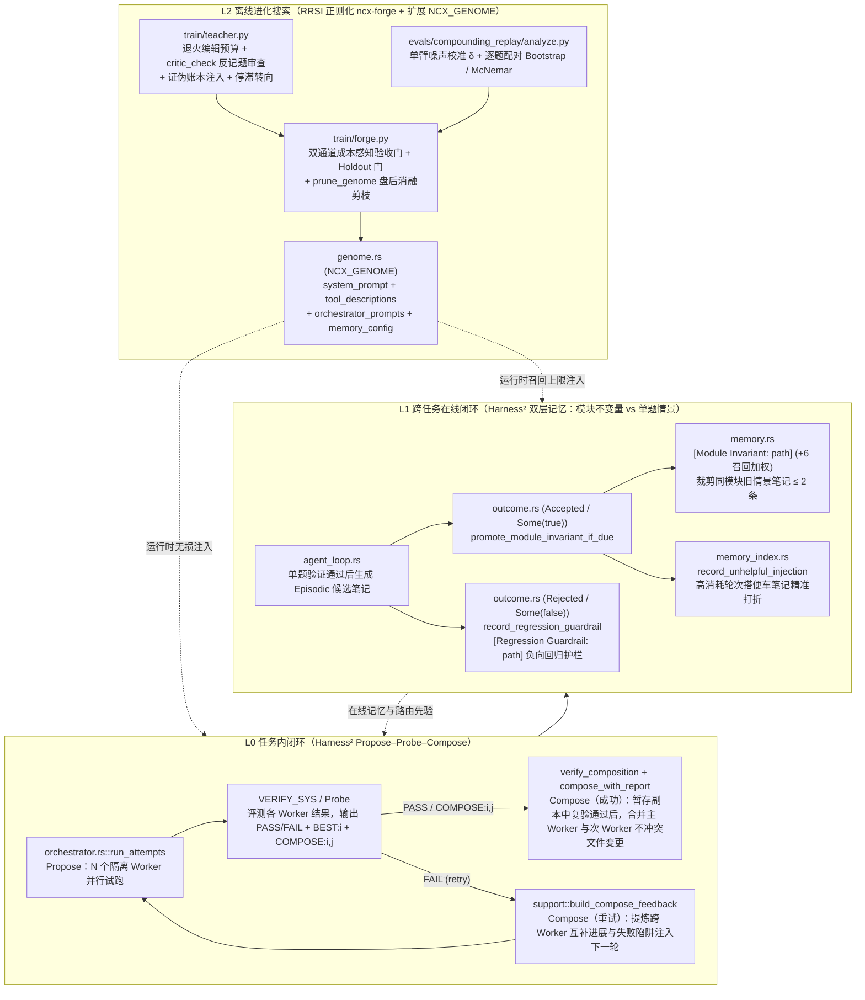

# BugleCat 自进化 Harness 架构与实现方案（对照 Google RRSI & Harness²，P0–P4 全量落地）

> [!NOTE]
> **理论对照说明**：本文对照 Google Research 的 **RRSI**（*Recursive Self-Improvement for Coding Agents*, `google-research/rrsi`, arXiv:2609.24972）与 **Harness²**（*Self-Evolving Harness via Within-Task Propose–Probe–Compose and Cross-Task Invariant Separation*, arXiv:2610.14224）两篇工作，系统梳理 BugleCat 的三层自进化闭环（L0 任务内 `Propose–Probe–Compose`、L1 跨任务双层记忆与回归护栏、L2 离线 `ncx-forge` RRSI 正则化搜索），并给出 P0–P4 的完整工程落点与实测统计结论。

---

## 1. 三层自进化闭环总览（L0 / L1 / L2）

| 层级 | 对应机制 | 核心代码落点 | 解决的核心问题 |
| :--- | :--- | :--- | :--- |
| **L0 任务内（Harness²）** | **Propose–Probe–Compose** | [`orchestrator.rs`](../rust/crates/ncx-core/src/orchestrator.rs)、[`orchestrator/support.rs`](../rust/crates/ncx-core/src/orchestrator/support.rs)、[`workspace_promotion.rs`](../rust/crates/ncx-core/src/workspace_promotion.rs) | 消除单纯 Best-of-N 丢弃其余 Worker 互补发现与非冲突子修改的浪费 |
| **L1 跨任务在线（Harness²）** | **模块不变量 vs 单题情景双层化 + 负向回归护栏 + 成本感知归因** | [`memory.rs`](../rust/crates/ncx-core/src/memory.rs)、[`memory_index.rs`](../rust/crates/ncx-core/src/memory_index.rs)、[`outcome.rs`](../rust/crates/ncx-core/src/outcome.rs)、[`turn.rs`](../rust/crates/ncx-core/src/agent_loop/turn.rs) | 消除长课程下同模块单题笔记无限堆积、原地更新丢失历史反馈权重、以及搭便车笔记混分 |
| **L2 离线搜索（RRSI）** | **退火编辑预算 + 反作弊 Critic + 证伪账本 + 双通道成本门 + 消融剪枝** | [`train/forge.py`](../train/forge.py)、[`train/teacher.py`](../train/teacher.py)、[`train/genome.py`](../train/genome.py)、[`genome.rs`](../rust/crates/ncx-core/src/genome.rs) | 防止 Teacher 整段重写提示词、硬编码测试集题号、重复已被证伪的修改或无收益膨胀 Token |
| **评测地基（P0）** | **单臂噪声下限 $\delta$ + 逐题配对统计检验 + 第二基准仓库** | [`analyze.py`](../evals/compounding_replay/analyze.py)、[`validate_gold.py`](../evals/compounding_replay/validate_gold.py)、[`mine_tasks.py`](../evals/compounding_replay/mine_tasks.py)、[`tasks/tabulate.jsonl`](../evals/compounding_replay/tasks/tabulate.jsonl) | 用配对 Bootstrap 95% CI 与非劣效护栏取代高方差的小样本单轮对比 |

---

## 2. Harness² 核心方案详解（任务内 Propose–Probe–Compose 与跨任务双层记忆）

### 2.1 L0 任务内闭环：`Propose → Probe → Compose`（P4）

在传统 Best-of-$N$ 编排中，$N$ 个 Worker 在隔离目录中各自独立执行，Verifier 只挑出一个 `BEST:<n>`，其余 $N-1$ 个 Worker 的工作与探测结论全部被直接丢弃。对照 **Harness²** 的任务内闭环思想，BugleCat 在编排层实现了双路径 **Compose**：

1. **路径 A —— 跨 Worker 非冲突文件级组合（[`workspace_promotion::compose_with_report`](../rust/crates/ncx-core/src/workspace_promotion.rs) & [`HarnessAgentRunner::compose_workers`](../rust/crates/ncx-core/src/orchestrator_runner.rs)）**：
   - `VERIFY_SYS` 明确告诉 Verifier：当其他 Worker 在不同文件上做了互补修改时，在 `BEST:2` 之后输出 `COMPOSE:2,1,3`（由 [`parse_compose_workers`](../rust/crates/ncx-core/src/orchestrator/support.rs) 解析，主 Worker 永远排在首位，越界编号忽略）。只有本轮验证 `PASS` 时才会组合；重试用尽仍未通过的轮次只提升最佳 Worker。
   - **先复验再提升**：[`Orchestrator::run_attempts`](../rust/crates/ncx-core/src/orchestrator.rs) 先调用 `runner.verify_composition`：把真实工作区复制成一次性副本、在副本中组合，再由可调用工具的验证者（`COMPOSE_VERIFY_SYS`，genome 键 `compose_verify_sys`）读文件、跑测试并给出 `PASS`/`FAIL`。只有 `PASS` 才调用 `runner.compose_workers(&composed)` 写入真实工作区；否则（或其余 Worker 全被剔除、runner 无法暂存）只提升最佳 Worker，并在最终结果中注明原因。验证者在副本中留下的文件随副本一起删除。
   - `compose_with_report` 按优先级遍历各 Worker 的隔离快照：
     - 主 Worker（`composed[0]`）相对于 `baseline` 的全部文件新增、修改、删除优先采纳；
     - 次级 Worker（`composed[1..]`）按 Worker 整体原子合并：只要它改动的任一文件与更早被采纳的 Worker 改了同一文件且 SHA-256 指纹不同，整个次级 Worker 就被剔除，绝不半合并；指纹完全一致的重叠修改可以合并。每个被提升的路径都按提供它的 Worker 的基线检查真实工作区是否漂移。
     - 同时将所有参与组合的 Worker 的 `SubrunTelemetry`（`tools_used`、`files_touched`、`recalled_note_ids`、`recovery_candidates`）合并归档，并通过 [`synthesize_composed`](../rust/crates/ncx-core/src/orchestrator/support.rs) 生成包含 `[Composed from Worker k]` 摘要的最终报告。

2. **路径 B —— 失败重试轮次的跨 Worker 探测合成（[`build_compose_feedback`](../rust/crates/ncx-core/src/orchestrator/support.rs)）**：
   - 当首轮 $N \ge 2$ 个 Worker 均未完全通过验证（`!verify_passed`）并进入重试轮次时，原先仅将 Verifier 的单行 `verdict` 传给下一轮。
   - 现在 `build_compose_feedback(&worker_results, &verdict)` 自动提取本轮所有 Worker 的探测结论摘要（`[Propose-Probe-Compose Peer Digest — combine complementary findings and avoid repeated traps]`），与 Verifier 的审查意见一并注入下一轮每个 Worker 的任务上下文，使下一轮 Worker 能够融合前序不同分支的定位进展并避开已踩过的陷阱。

### 2.2 L1 跨任务闭环：通用模块不变量 vs 单题特例 + 负向回归护栏（P3）

对照 **Harness²** "将单任务修改分离为可跨任务复用的结构性不变量（Reusable Invariants）与单题特定实现（Task-Specific Edits）"的核心设计：

1. **模块级不变量自动提炼与单题情景笔记硬顶（[`MemoryStore::promote_module_invariant_if_due`](../rust/crates/ncx-core/src/memory.rs)）**：
   - **前提**：以下 L1 机制只在 `[feedback] memory = "on"` 时运行；默认 `"shadow"` 模式不写入任何学习笔记。
   - 每当同一源码模块（排除 `.ncx`、`.nanocodex`、`tests/`、`test/`）在外部裁判确认通过（[`outcome.rs`](../rust/crates/ncx-core/src/outcome.rs) 的 `Some(true)` 分支）后累计达到 **`>= 2` 条**验证笔记时，把该模块最新（最多 3 条）已验证笔记的片段（每条截取前 120 字符，用 ` | ` 连接）合并为一条模块级不变量，生成或原地更新：
     `[Module Invariant: <module_path>] <片段1> | <片段2> | <片段3>`（带 `invariant` 标签）。这是对最近验证结论的压缩摘要，并非符号级抽取。
   - **单题情景层淘汰上限**：一旦某模块拥有模块不变量，该模块名下的旧单题情景笔记自动裁剪至最多保留最新 **`MAX_EPISODIC_PER_MODULE = 2` 条**，并立即调用 `index.rebuild_from_markdown` 同步 SQLite 索引。这样即便在同一模块上连续跑数十道题，该模块占用的记忆条数恒定有界（$\le 1 \text{ invariant} + 2 \text{ episodic} = 3$ 条）。

2. **负向回归护栏记忆（[`MemoryStore::record_regression_guardrail`](../rust/crates/ncx-core/src/memory.rs)）**：
   - 当某次修改在 [`outcome.rs`](../rust/crates/ncx-core/src/outcome.rs) 的 `Some(false)` 分支中被明确报告为**破坏已有功能的回归**（裁判报告 `p2p_regressed > 0`，或负向标注中出现未被否定的 `regress`/`回归`；"no regressions"、"未引入回归" 这类否定说法不算，单纯的 Checkpoint `Rollback` 也不算）时，在清除本轮错误正向笔记的同时，自动按修改过的非测试模块写入或原地更新一条负向护栏：
     `[Regression Guardrail: <module_path>] Caution editing <module_path>: prior patch caused regression (<reason>); run full module tests to preserve pass-to-pass behavior.`（标签：`["guardrail", "regression"]`）。
   - 若仅因未修完新功能或超时/超预算被判 `bad`（`p2p_regressed=0`），则不写入回归护栏，防止噪声污染记忆库。
   - **护栏会失效**：之后某次修改同一模块的任务被验证通过时，`MemoryStore::clear_regression_guardrail` 会删除该模块的护栏并从索引中移除，避免警告永久累积并持续占用 `+6` 召回加分。

3. **规范化头部 `note_id` 哈希与 `+6` 召回优先级（[`MemoryStore::note_id`](../rust/crates/ncx-core/src/memory.rs) & `semantic_score`）**：
   - `[Module Invariant: <module>]` 与 `[Regression Guardrail: <module>]` 在 `MemoryStore::note_id` 中均按规范化模块头（`[module invariant: <module>]` / `[regression guardrail: <module>]`）计算 SHA-256，确保原地更新正文时永久保留同一个 `note_id` 及 SQLite `memory_feedback` 表中积累的 Beta 后验权重。
   - 在 `semantic_score` 中，命中当前任务关键词的不变量与护栏条目额外获得 **`+6` 分**结构性加权，配合收紧后的默认召回上限（`6 条 / 2400 字符`），确保高信噪比的模块级规律优先注入。

4. **高消耗轮次成本感知反馈归因（[`MemoryIndex::record_unhelpful_injection`](../rust/crates/ncx-core/src/memory_index.rs)）**：
   - 在高消耗轮次（`iterations > 16 || tool_calls > 24 || total_tokens > 80_000`）完成时，仅与本轮实际修改文件名匹配的召回笔记获得 `accepted + 1`，未匹配的"搭便车"召回笔记仅记 `injected + 1`（降低其 Beta 后验分）。

---

## 3. Google RRSI 核心方案详解（L2 离线 `ncx-forge` 正则化与扩展 `NCX_GENOME`）

### 3.1 扩展 `NCX_GENOME` 可进化表面（P2）

在 [`rust/crates/ncx-core/src/genome.rs`](../rust/crates/ncx-core/src/genome.rs) 与 [`train/genome.py`](../train/genome.py) 中，将可进化表面从原先的 2 个扩展为 4 大类（保持冻结文件 `prompt.rs` 零修改，且空 Genome 100% 字节级 No-op）：
1. `system_prompt`：主 Agent 循环系统提示词；
2. `tool_descriptions`：各工具 schema 描述覆盖；
3. `orchestrator_prompts`（新增）：覆盖编排器全部 5 个阶段提示词（`classify_sys`、`plan_sys`、`decompose_sys`、`worker_sys`、`verify_sys`）；
4. `memory_config`（新增）：有界覆盖在线记忆召回预算（`max_entries` $\in [1, 32]$、`max_chars` $\in [200, 16000]$）。

### 3.2 `ncx-forge` 五重 RRSI 正则化（P1）

1. **表面级退火编辑预算（[`train/genome.py`](../train/genome.py)）**：`changed_surfaces` 与 `changed_lines` 精确度量每个候选相对于父代修改的表面列表与非空行数；开启 `--anneal-surfaces` 时，第 $r$ 轮最多允许修改 $\max(1, \text{max\_surfaces} - \lfloor r / 2 \rfloor)$ 个表面且不超过 `--max-changed-lines` 行。
2. **规则版反作弊审查器（[`train/teacher.py::critic_check`](../train/teacher.py)）**：扫描候选相对于父代新增的行（`+ `），一旦出现训练集任务 ID、`check.py`、`_check.py`、`hidden test` 或 `eval_holdout`，直接本地拦截并记为 `rejected_critic`。
3. **证伪假设账本与停滞转向（[`train/forge.py`](../train/forge.py)）**：所有候选写入 `train/runs/ledger_<stamp>.jsonl`，将最近 6 条被拒/证伪修改注入 Teacher Prompt（`Falsified / Rejected Mutations`）；连续 `--stagnation-limit` 轮无晋级时自动挑选探索最少的表面作为下一轮 `focus_surface`。
4. **双通道成本感知验收门**：支持「通过数提升且未触发 `--max-token-growth` 膨胀护栏」或「通过数不降且平均 Token 节省 $\ge \text{delta\_tokens}$」两条晋级通道，并统一由 Holdout 非退化门把关。
5. **盘后结构化消融剪枝（[`prune_genome`](../train/forge.py)，`--prune`）**：搜索结束后对最终 Champion 逐个回滚被修改表面，若回滚后 train/holdout 分数与 Token 均不恶化，则永久剔除该搭便车冗余修改。

---

## 4. P0 配对统计评测与 `python-tabulate` 三臂实测结论

- **评测工具链**：[`evals/compounding_replay/analyze.py`](../evals/compounding_replay/analyze.py)（单臂 Jeffreys 平滑噪声下限 $\delta$ + 双臂精确 McNemar + 4000 次按题配对 Bootstrap 95% CI）、[`validate_gold.py`](../evals/compounding_replay/validate_gold.py)（官方补丁黄金验证 `tabulate` 9/9 通过）。
- **`python-tabulate` 9 题课程三臂实测结果（`deepseek-chat`，单题上限 `0.30` 元）**：

| 指标 | Arm A（无记忆，3 轮均值） | Arm B（单层记忆，3 轮均值） | Arm B'（P3 双层记忆，单轮实测） | B vs A 配对统计检验（[`tab_cal_AB.json`](../evals/compounding_replay/runs/tab_cal_AB.json)） |
| :--- | :--- | :--- | :--- | :--- |
| 运行 ID | `1043*-A-tab-cal-r1..r3` | `1101*-B-tab-cal-r1..r3` | `115758-B-tab-p3-r1` | 3 轮 × 9 题 = 27 次配对 |
| 严格解决率（`resolved`） | `7/9, 7/9, 7/9`（**77.8%**, 21/27） | `7/9, 8/9, 7/9`（**81.5%**, 22/27） | `7/9`（**77.8%**） | `+3.7pt >= -14.9pt`（通过非劣效护栏，McNemar $p=1.0$） |
| 裁判通过率（`judge_ok`） | `8/9, 8/9, 7/9`（23/27） | `8/9, 8/9, 8/9`（24/27） | `8/9`（`#241` 花 `0.313` 元） | `#241` 在 B-r2 仅花 `0.137` 元（`36.5s`）通过 |
| 每轮总成本（CNY） | `1.521 / 1.542 / 1.695`（均值 **1.586**） | `1.312 / 1.119 / 1.508`（均值 **1.313**） | **1.413**（较 A 省 `0.173` 元） | `B - A = -0.2728` 元/轮，配对 95% CI `[-0.5207, -0.0685]` |
| **每解决一题成本（`cpr`）** | **0.2265 CNY** | **0.1790 CNY**（**-21.0%**） | **0.2018 CNY**（**-10.9%**） | **`B / A = 0.7904`，配对 95% CI `[0.6239, 0.9523]`（不含 1.0，显著）** |
| 期末 `learnings_entries` | `0` | `8`（随题数线性膨胀） | **`6`（第 4～9 题全程硬封顶）** | 2 条 `[Module Invariant]` + 每模块最多 2 条情景笔记 |
